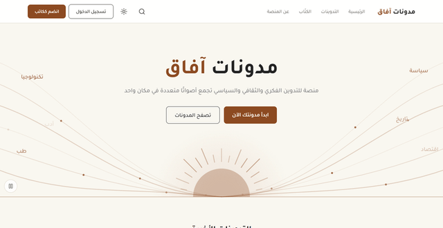
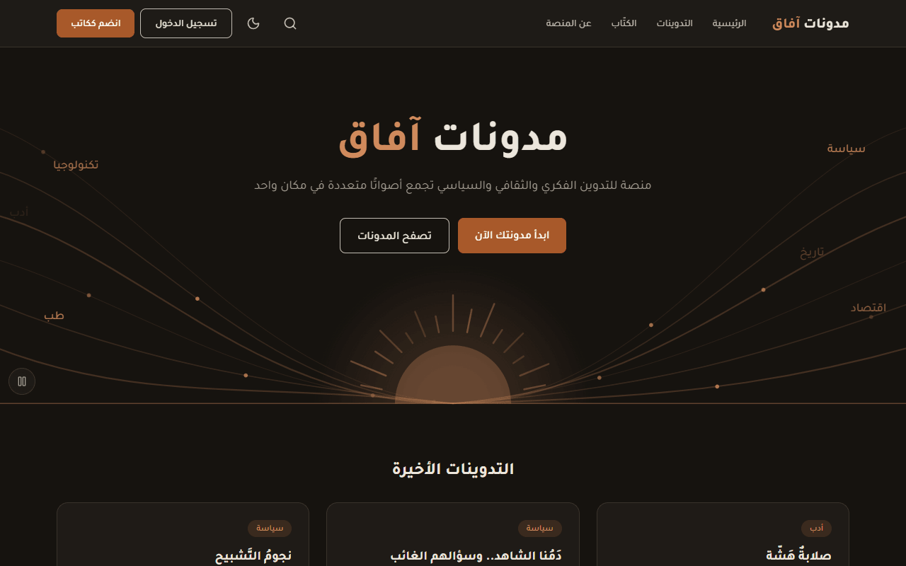
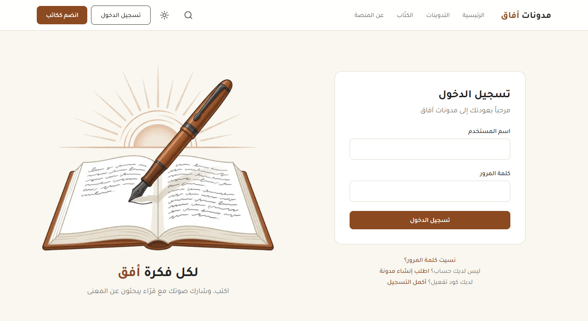
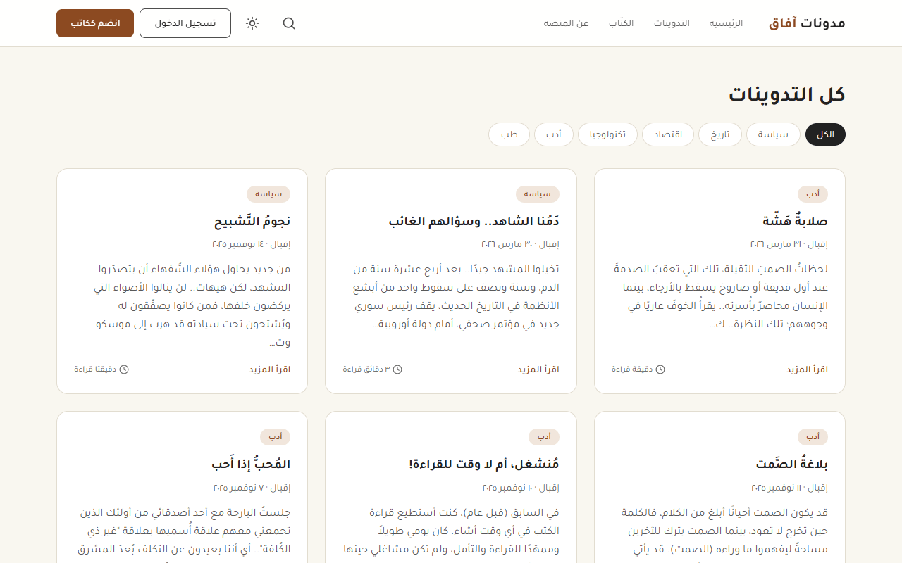
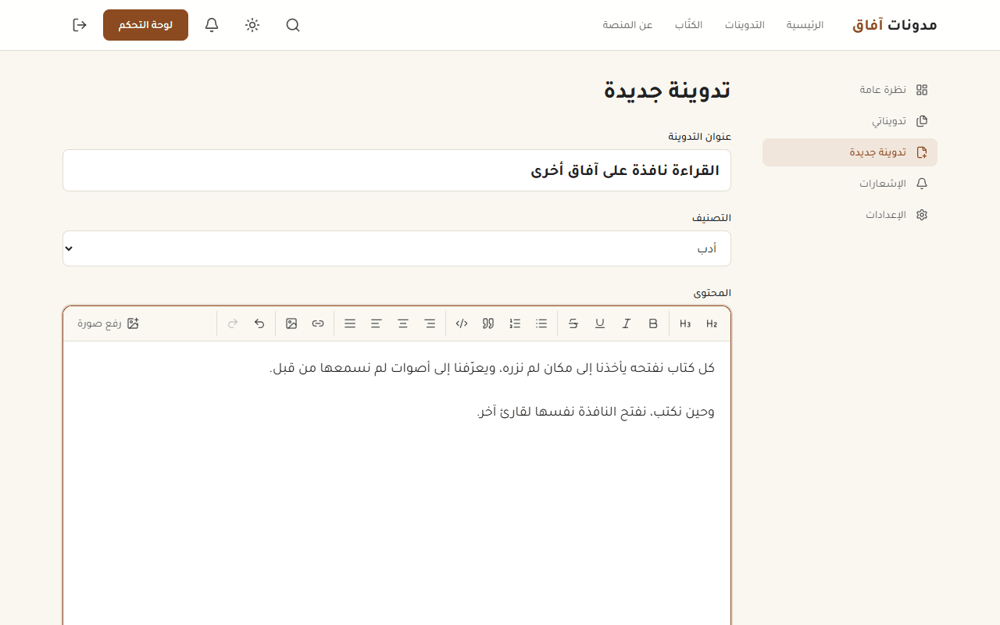
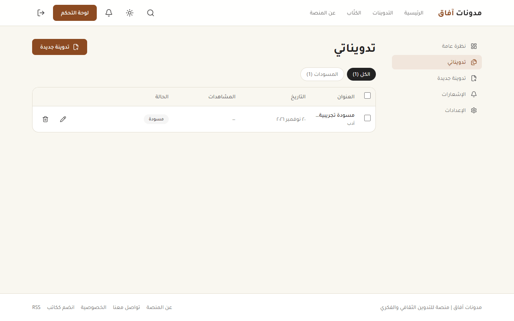
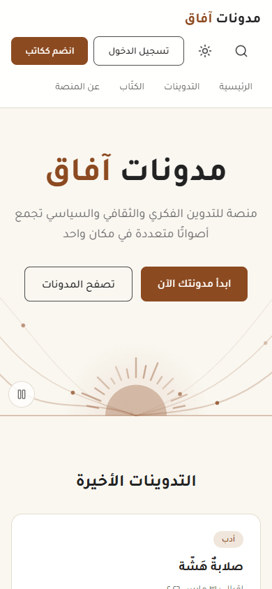
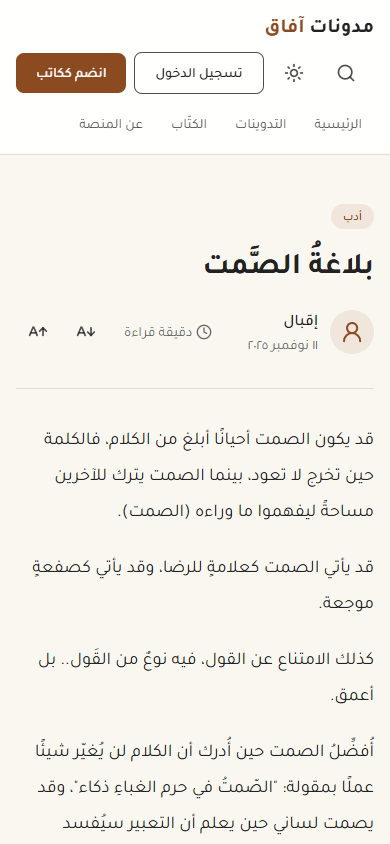
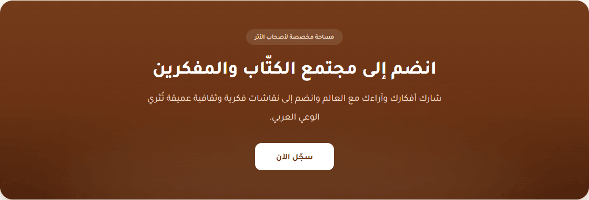
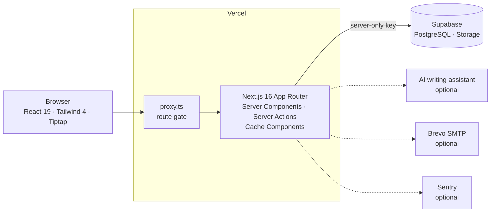

<div align="center">

# مدونات آفاق · Afaq Blogs

**لكل فكرة أفق** · *Every idea has its horizon*

An Arabic-first publishing platform for intellectual, cultural and political writing.

[](https://github.com/Eqbal-eo/Blog/actions/workflows/ci.yml)


### [Visit the live site →](https://blog-eight-chi-26.vercel.app)



</div>

<div dir="rtl">

**مدونات آفاق** منصة عربية للتدوين الفكري والثقافي والسياسي، تجمع أصواتًا متعددة في مكان واحد. ينضم الكاتب بطلب يراجعه المشرف، وتُراجع تدويناته قبل النشر، ويحصل القارئ على تجربة قراءة عربية سريعة من اليمين إلى اليسار، بمظهر فاتح وداكن.

</div>

## Contents

[Screenshots](#screenshots) · [Features](#features) · [Status of the live site](#status-of-the-live-site) · [Architecture](#architecture) · [Security](#security) · [Getting started](#getting-started) · [Testing](#testing) · [Deployment](#deployment) · [Project layout](#project-layout) · [Acknowledgements](#acknowledgements)

## Screenshots

| Home | Home, dark mode |
|:---:|:---:|
|  |  |
| **Sign in** | **All posts** |
|  |  |
| **Article, dark mode** | **Editor** |
|  |  |
| **Writer dashboard** | **Post management** |
|  |  |

<p align="center">
  
  &nbsp;&nbsp;
  
</p>



## Features

### For readers

- Arabic full-text search that ignores diacritics and letter variants
  («صلابه» finds «صلابةٌ», «اسرائيل» finds «إسرائيل»)
- Categories, writer pages, pagination and a most-read list
- Reading time, progress bar and adjustable font size
- Light theme by default, with dark and follow-the-device options
- An interactive animated hero that can be paused and respects reduced motion
- Moderated comments, RSS, and a double opt-in newsletter per site or per writer

### For writers

- A right-to-left Tiptap editor with image upload by button, paste or drop
- Large images shrink in the browser, then are re-encoded without location metadata
- Drafts, review with feedback, notifications, view counts and profile settings
- An optional AI writing assistant: Arabic proofreading, plus title and
  description ideas. It only suggests; the writer decides what to apply

### For editors

- Review queues for posts, writer applications and comments
- Onboarding with single-use invite codes that expire after seven days

### For sharing and discovery

- Sitemap, robots file, page metadata and an RSS feed
- Generated share images that render Arabic correctly

## Status of the live site

Some features depend on external services and stay off until their keys are set.

| Feature | In the code | On the live site |
|---|:---:|---|
| Reading, search, RSS, sign-in, editor, image upload | ✅ | Live |
| AI writing assistant | ✅ | Coming soon: not enabled yet |
| Email: invite codes, account recovery, newsletter | ✅ | Not enabled yet: needs Brevo SMTP |
| Public demo account | ✅ | Not enabled |
| Error monitoring (Sentry) | ✅ | Not enabled |

## Architecture



| Layer | Technology |
|---|---|
| Framework | Next.js 16 (App Router, Cache Components), React 19, TypeScript |
| Interface | Tailwind CSS 4, Tiptap 3, Lucide icons, Canvas 2D |
| Data | Supabase: PostgreSQL and Storage |
| Auth | Signed HTTP-only cookie (jose), bcrypt |
| Validation | Zod, sanitize-html |
| Images | sharp, next/image |
| Email | React Email, Nodemailer, Brevo |
| AI | Language-model API with structured outputs |
| Quality | ESLint, Vitest, Playwright, GitHub Actions |
| Hosting | Vercel, Vercel Analytics |

## Security

- **Data access is server-side.** The browser holds no database key, and row
  level security gives the public key no access to the tables.
- **Protected actions re-check the user.** The role is read from the database
  on each request instead of being trusted from the cookie.
- **Post HTML is sanitized** with an allowlist when saved and when rendered.
- **Rate limits live in Postgres**, so they hold across serverless instances:
  sign-in, registration, account recovery, comments, uploads and the assistant.
- **Uploads are validated and re-encoded**, except animated GIFs, which are
  checked and stored as they are.

## Getting started

You need Node.js 20.9 or newer (CI uses 22) and a Supabase project.

> [!IMPORTANT]
> The SQL in `supabase/migrations/` upgrades an existing Afaq database. It does
> not create the base tables (`users`, `posts`, `settings`, `blog_requests`,
> `invite_codes`, `notifications`), so it will not work on an empty project.

```bash
git clone https://github.com/Eqbal-eo/Blog.git
cd Blog
npm install
cp .env.example .env
npm run dev
```

Fill in `.env` before starting, then open http://localhost:3000.

| Variable | Needed for |
|---|---|
| `SUPABASE_URL` | **Required** |
| `SUPABASE_SERVICE_ROLE_KEY` | **Required.** Use a server-only `sb_secret_…` key |
| `JWT_SECRET` | **Required.** A long random string that signs sessions |
| `WEBSITE_URL` | Correct links in email, feeds and metadata |
| `BREVO_USER`, `BREVO_SMTP_KEY`, `BREVO_SENDER_EMAIL` | Sending email |
| `ADMIN_EMAIL` | Alerts about new writer applications |
| `ANTHROPIC_API_KEY` | The writing assistant |
| `CRON_SECRET` | The daily reset of the demo account |
| `SENTRY_*` | Error monitoring |

The optional demo account is described in [`.env.example`](.env.example).

For an existing database, run these once, in order, in the Supabase SQL Editor:

| Migration | Adds |
|---|---|
| `20261116000000_lock_down_public_tables.sql` | Row level security on the public tables |
| `20261117000000_rate_limits.sql` | Rate-limit storage |
| `20261118000000_reader_features.sql` | Image bucket, views, Arabic search, comments, newsletter |
| `20261120000000_post_summary.sql` | An optional description for each post |

## Testing

| Command | Does |
|---|---|
| `npm run lint` | ESLint |
| `npm run typecheck` | TypeScript |
| `npm test` | Unit tests |
| `npm run build` | Production build |
| `npm run test:e2e` | Browser tests against the production build |

> [!WARNING]
> The browser tests use the configured database. Opening a post increases its
> view count and submitting forms increases rate-limit counters, so point them
> at a test database.

CI runs lint, type checks and unit tests on pull requests and on `main`. Browser
tests run there only when the repository secrets for a database are set.

## Deployment

1. Import the repository in Vercel. `vercel.json` already selects Next.js.
2. Add the variables above to both **Production** and **Preview**.
3. Keep **Standard Protection** on, so old and preview deployments stay private.
4. Redeploy after changing a variable: existing deployments keep the old values.

Uploads are capped at 4 MB on the server because Vercel rejects request bodies
over 4.5 MB.

## Project layout

```text
src/
  app/
    (auth)/       sign-in, registration, writer application, account recovery
    dashboard/    overview, posts, editor, notifications, settings
    admin/        review of posts, applications and comments
    article/  articles/  category/  search/  author/  blogs/
    api/cron/     scheduled jobs
  assets/         fonts and artwork
  components/     header, editor, hero, banner, forms
  lib/            data, auth, AI, email, media, search
  proxy.ts        gate for the dashboard and admin areas
supabase/
  migrations/     database upgrades
tests/            unit and browser tests
docs/
  screenshots/    images used in this README
```

## Acknowledgements

Sincere thanks to **Ömer Teknoloji** for the internship opportunity and for their trust.

<div dir="rtl">

جزيل الشكر والتقدير إلى شركة **Ömer Teknoloji** على فرصة التدريب وعلى ثقتهم.

</div>
