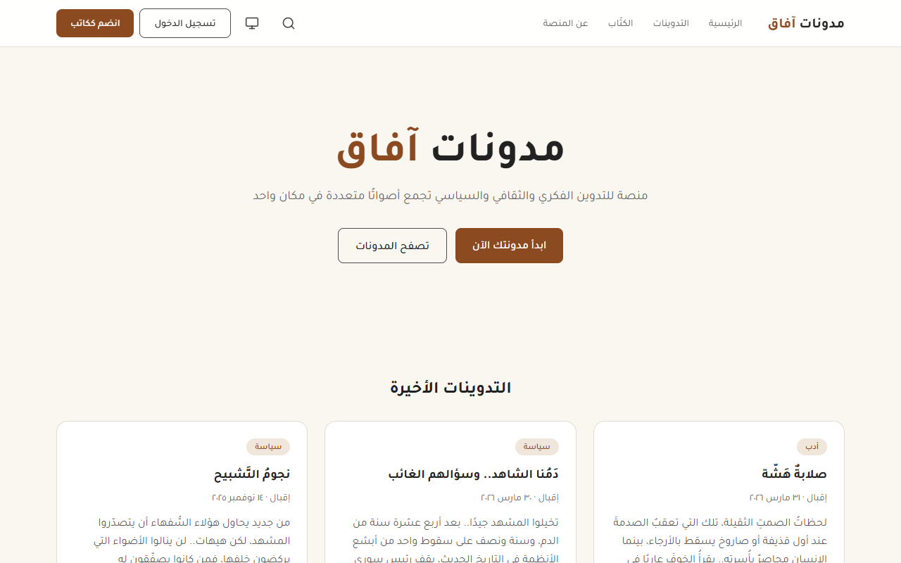
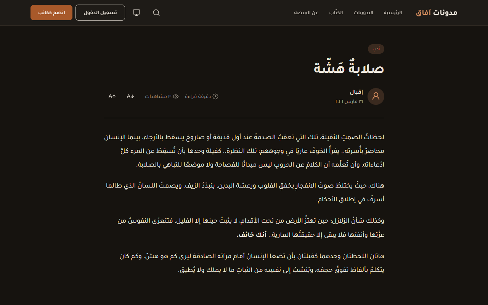
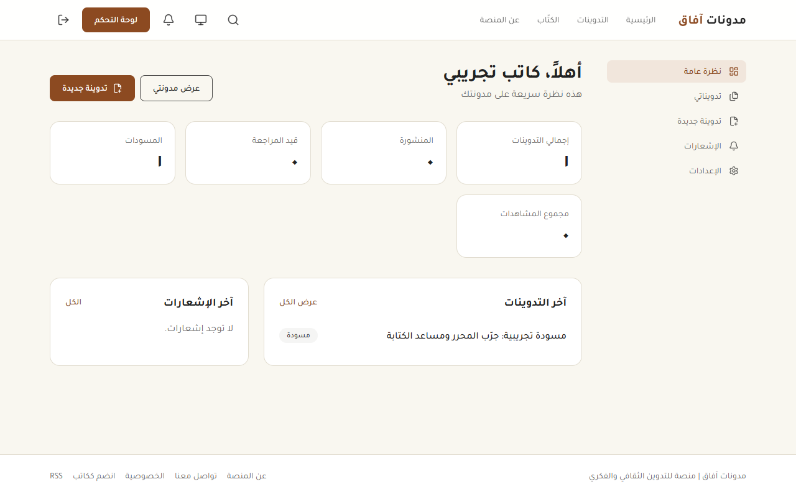
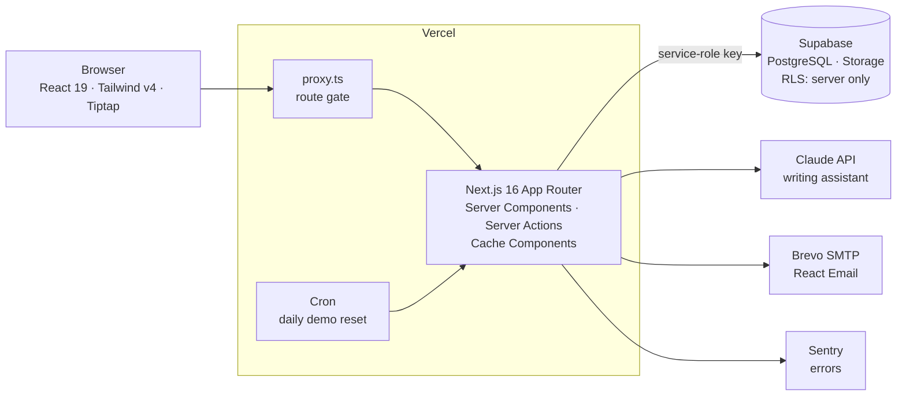

# مدونات آفاق · Afaq Blogs

An Arabic blogging platform for cultural, intellectual and political writing.
Writers apply to join, editors review every post before it goes live, and
readers get a fast, right-to-left reading experience.



**Try the writer dashboard:** sign in at `/login` with the demo account; its
sign-in details are shown on the login page. The demo account writes drafts only and is
reset every day.

## Highlights

**For readers**
- Arabic full-text search that ignores diacritics and letter variants
  («صلابه» finds «صلابةٌ», «اسرائيل» finds «إسرائيل»)
- All posts and category pages with pagination, most-read posts
- Reading time, reading progress bar, adjustable font size, dark mode
- Moderated comments and an email newsletter (whole site or per writer,
  double opt-in, one-click unsubscribe)

**For writers**
- Tiptap rich-text editor built for Arabic (RTL), with image upload by
  button, paste or drop; images are resized to WebP with EXIF removed
- **Writing assistant (Claude):** Arabic proofreading that suggests
  individual corrections, plus title and summary ideas. Suggestions only;
  nothing changes until the writer applies it
- Drafts, review workflow with feedback, notifications, view counts,
  profile picture, account recovery by email

**For editors**
- Review queues for posts, writer applications and comments
- Invite-code onboarding: approved applicants get a single-use code by email

**Reach**
- `sitemap.xml`, `robots.txt`, RSS at `/rss.xml`
- Generated share images that render Arabic correctly, right to left

| Article (dark mode) | Writer dashboard | Editor |
|---|---|---|
|  |  |  |

## Architecture



- **All data access is server-side.** The browser never holds a database
  key; row level security blocks the public key on every table.
- **Every Server Action re-checks** the signed-in user, and the role is read
  from the database on each request, not trusted from the cookie.
- **Post HTML is sanitized** with an allowlist when saved and again when
  rendered.
- **Rate limits** (login, registration, account recovery, comments, uploads,
  the writing assistant) are stored in Postgres, so they hold on serverless.

## Stack

Next.js 16 · React 19 · TypeScript · Tailwind CSS v4 · Supabase (PostgreSQL,
Storage) · Tiptap 3 · Zod · Claude API (Anthropic SDK) · React Email + Brevo ·
sharp · Sentry · Vercel Analytics · Vitest · Playwright · GitHub Actions

## Getting started

```bash
npm install
cp .env.example .env   # then fill it in
npm run dev            # http://localhost:3000
```

Run the SQL files in `supabase/migrations/` once, in order, in
**Supabase → SQL Editor**:

| File | Adds |
|---|---|
| `20261116000000_lock_down_public_tables.sql` | Row level security on every table; the public key can read nothing |
| `20261117000000_rate_limits.sql` | `rate_limits` table and `hit_rate_limit()` |
| `20261118000000_reader_features.sql` | Image bucket, view counts, Arabic search, comments, newsletter |
| `20261120000000_post_summary.sql` | Optional per-post summary (search and link previews) |

Create the public demo account (optional):

```bash
node --env-file=.env scripts/create-demo-account.mjs
```

## Scripts

| Command | Does |
|---|---|
| `npm run dev` | Development server |
| `npm run build` / `npm start` | Production build and server |
| `npm run lint` / `npm run typecheck` | ESLint / TypeScript |
| `npm test` | Unit tests (Vitest) |
| `npm run test:e2e` | End-to-end tests (Playwright) against a production build; read-only |

CI runs lint, types and unit tests on every push. The end-to-end job runs
when the repository has the `SUPABASE_URL`, `SUPABASE_SERVICE_ROLE_KEY` and
`JWT_SECRET` secrets.

## Deploying to Vercel

1. Import the repository (framework: Next.js).
2. Add the variables from `.env.example` under **Settings → Environment
   Variables**. Required: the Supabase, JWT, Brevo and `WEBSITE_URL` values.
   Optional: `ANTHROPIC_API_KEY` (writing assistant), `DEMO_PASSWORD` and
   `CRON_SECRET` (demo account), `SENTRY_*` (error monitoring).
3. Enable **Analytics**. The daily demo reset is scheduled in `vercel.json`.

## Project layout

```
src/
  app/
    (auth)/        login, register, blog request, account recovery
    dashboard/     writer area: overview, posts, editor, notifications, settings
    admin/         review of posts, writer applications and comments
    article/ articles/ category/ search/ author/ blogs/   public pages
    api/cron/      scheduled jobs
  components/      header, dashboard shell, editor and writing assistant, forms
  lib/             data access, auth, AI, email, media, newsletter, search
  proxy.ts         sends signed-out visitors from /dashboard and /admin to login
supabase/migrations/   SQL to run once in Supabase
tests/             unit (Vitest) and end-to-end (Playwright) tests
```
